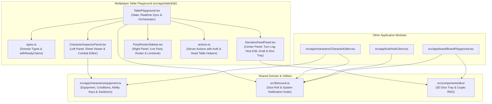

# D&D Playground — Project Refactoring Guide

This document explains the architectural refactoring performed across the **D&D Playground** codebase, why each change was made, and how the resulting modules fit together.

---

## 1. Objectives & Design Principles

1. **Single Responsibility Principle (SRP)**: Break down monolithic UI files (such as the 1,280+ line `TablePlayground.tsx`) into focused, maintainable domain components and type modules.
2. **Single Source of Truth (DRY)**: Eliminate duplicated constants, equipment slot definitions, character condition lists, and stat/HP sanitization logic across the Character Codex and Table Playground.
3. **Server Action Hygiene**: Consolidate repeated authentication and Head Table authorization boilerplate in server actions while respecting Next.js `'use server'` export constraints (only exporting `async` functions from server action files).
4. **Centralized Notification Audio System**: Provide a unified, browser-autoplay-resilient sound notification module (`src/lib/sound.ts`) covering all dice roll tiers and system events.
5. **Strict React 19 / Next.js Compliance**: Replace synchronous `setState` calls inside `useEffect` hooks with lazy state initializers (`useState(() => ...)`), eliminating cascading renders and passing ESLint's `react-hooks/set-state-in-effect` checks with zero warnings.

---

## 2. Architecture Overview (Before vs. After)

### Before Refactoring
- `src/app/table/[id]/TablePlayground.tsx` (~1,284 lines) held all domain types, optimistic ready-claim logic, realtime Supabase channels, clock offset synchronization, sound triggers, and three separate UI panels (Character Inspector, Narrative Feed + Dice Tray, and Party Roster + Lorebook) in a single file.
- `EQUIPMENT_LABELS`, `EMPTY_EQUIPMENT`, and `CONDITIONS` were duplicated across `src/app/characters/equipment.ts`, `src/app/characters/CharacterEditor.tsx`, and `src/app/table/[id]/TablePlayground.tsx`.
- Server actions in `src/app/table/[id]/actions.ts` repeated the same Supabase session lookup and Head Table ownership queries across every exported function.

### After Refactoring

---

## 3. Detailed Breakdown of How It Was Done

### 3.1 Modularizing the Multiplayer Table Playground (`src/app/table/[id]/`)

The monolithic `TablePlayground.tsx` was decomposed into five cohesive files:

| File | Responsibility |
| :--- | :--- |
| [`src/app/table/[id]/types.ts`](src/app/table/[id]/types.ts) | Defines `Character`, `Member`, `Turn`, `LorebookEntry`, `TableData`, `TablePlaygroundProps`, `CharacterCombatFormState`, `ReadyClaim`, and the optimistic concurrency helper `withReadyClaims()`. |
| [`src/app/table/[id]/CharacterInspectorPanel.tsx`](src/app/table/[id]/CharacterInspectorPanel.tsx) | Renders the **Left Panel**: Character switcher, inline combat state editor (HP, Max HP, AC, Condition, Ability Scores, Inventory, Equipment Slots), and read-only character inspector. |
| [`src/app/table/[id]/NarrativeFeedPanel.tsx`](src/app/table/[id]/NarrativeFeedPanel.tsx) | Renders the **Center Panel**: Turn narrative cards, Head Table narrative override editor, AI resolution loading indicator, synchronized countdown banner, action draft bar, and the 3D `DiceRoller` popover. |
| [`src/app/table/[id]/PartyRosterSidebar.tsx`](src/app/table/[id]/PartyRosterSidebar.tsx) | Renders the **Right Panel**: Live Party Roster (`READY` / `DRAFTING` badges, real-time declared actions, Host Kick action) and the Campaign Lorebook quick-lookup list. |
| [`src/app/table/[id]/TablePlayground.tsx`](src/app/table/[id]/TablePlayground.tsx) | Acts as a focused **State & Realtime Orchestrator**: manages Supabase `postgres_changes` and `broadcast` channels, server clock offset synchronization, sound effect hooks, and server action handlers. |

---

### 3.2 Consolidating Character Constants & Sanitizers (`src/app/characters/equipment.ts`)

Because Next.js `'use server'` files (`actions.ts`) can only export `async` functions, shared non-function constants and pure helper functions belong in [`src/app/characters/equipment.ts`](src/app/characters/equipment.ts):

- **`EQUIPMENT_LABELS` & `EMPTY_EQUIPMENT`**: 6-slot equipment array definitions (`Head`, `Torso`, `Leg`, `Foot`, `Left Hand`, `Right Hand`).
- **`CHARACTER_CONDITIONS`**: Canonical condition list (`Normal`, `Bloodied`, `Poisoned`, `Stunned`, `Blinded`, `Unconscious`, `Blessed`, `Charmed`, `Exhausted`).
- **`ABILITY_SCORE_KEYS` & `DEFAULT_ABILITY_SCORES`**: Canonical `['STR', 'DEX', 'CON', 'INT', 'WIS', 'CHA']` keys and default values.
- **`sanitizeAbilityScores(stats, fallback)`**: Normalizes arbitrary form input values into finite numeric ability scores.
- **`clampHpValues(currentHp, maxHp)`**: Ensures `maxHp >= 1` and `0 <= currentHp <= maxHp`.

Both [`CharacterEditor.tsx`](src/app/characters/CharacterEditor.tsx) and [`CharacterInspectorPanel.tsx`](src/app/table/[id]/CharacterInspectorPanel.tsx) now import from this single module.

---

### 3.3 Cleaning Up Server Actions (`src/app/table/[id]/actions.ts`)

In [`src/app/table/[id]/actions.ts`](src/app/table/[id]/actions.ts), repeated authentication and permission checks were extracted into internal helpers:

- **`requireAuthenticatedUser()`**: Creates the server Supabase client, verifies `supabase.auth.getUser()`, throws `'Not authenticated'` if missing, and returns `{ supabase, user }`.
- **`assertHeadTable(supabase, tableId, userId, errorMessage)`**: Verifies the table exists and that `table.head_table_id === userId` before allowing host-only actions (`hostOverrideNarrative`, `voteKickMember`).

---

### 3.4 Extracting Hub Subcomponents (`src/app/hub/HubClient.tsx`)

In [`src/app/hub/HubClient.tsx`](src/app/hub/HubClient.tsx):
- Extracted `ActiveTableCard` into a dedicated presentational component alongside `CampaignCard` and `LaunchButton`, simplifying the main `HubClient` render tree.
- Connected error handlers (`handleDeleteTable`, `handleLeaveTable`, `handleDeleteCampaign`, `handleJoin`) to the centralized notification sound system.

---

### 3.5 Notification Sound System (`src/lib/sound.ts`)

Created [`src/lib/sound.ts`](src/lib/sound.ts) and copied the audio assets from `assets/sound/*.wav` to `public/assets/sound/*.wav` so Next.js serves them statically with byte-range support:

| Category | Trigger Condition | Sound File |
| :--- | :--- | :--- |
| **Dice Roll** | Roll total `< 10` | `/assets/sound/roll_under_10.wav` |
| **Dice Roll** | Roll total `>= 10` and `< 15` | `/assets/sound/roll_more_than_10_under_15.wav` |
| **Dice Roll** | Roll total `>= 15` | `/assets/sound/roll_more_than_15.wav` |
| **System** | Player enters Table Playground / new player joins table | `/assets/sound/player_enter_table.wav` |
| **System** | AI Dungeon Master replies with a new turn | `/assets/sound/Ai_reply.wav` |
| **System** | Any action or network error occurs | `/assets/sound/error.wav` |

Includes an automatic user-gesture unlock fallback (`attachAutoplayUnlock`) so if a browser blocks `player_enter_table.wav` on a hard page refresh (`NotAllowedError`), it plays on the user's first pointer or keyboard interaction.

---

### 3.6 React 19 Hook & State Hygiene (`src/app/login/page.tsx`)

- Replaced the `useEffect` in [`src/app/login/page.tsx`](src/app/login/page.tsx) that synchronously called `setErrorMsg(...)` on mount with a lazy `useState(() => ...)` initializer reading `window.location.search`, preventing unnecessary double renders.

---

## 4. Verification

The refactored codebase was verified with:
- **`npm run lint` (`eslint`)**: Passed with **0 errors and 0 warnings**.
