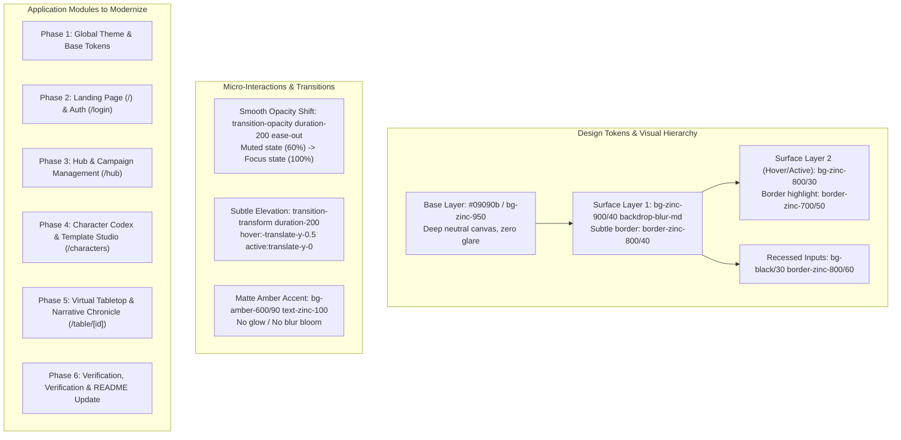

# Implementation Plan: Sitewide Modern Minimalist UI Redesign (Smooth Fade & Opacity Architecture)

> **Objective:** Modernize the entire user interface of TofuTablePlay into a clean, sleek, distraction-free "Modern Minimalist Dark / Swiss Dark" design system. The aesthetic strictly avoids harsh glowing lights, bloom, and neon effects, and instead leverages **layered opacity surfaces (`backdrop-blur-md`, subtle alpha channels)**, **smooth fade micro-interactions**, **matte amber accents**, and **refined typography & spacing**.
>
> **Status:** 100% Completed & Verified. Zero TypeScript errors, zero ESLint errors/warnings.

---

## 1. Design System & Philosophy: "Smooth Fade & Layered Opacity"

### 1.1 Visual Token Reference
- **Surfaces**:
  - `Base`: `bg-zinc-950`
  - `Card / Panel`: `bg-zinc-900/40 backdrop-blur-md border border-zinc-800/50`
  - `Card Hover`: `hover:bg-zinc-800/30 hover:border-zinc-700/60 transition-all duration-200 ease-out`
  - `Modals / Drawers`: `bg-zinc-900/90 backdrop-blur-xl border border-zinc-800/80 shadow-2xl shadow-black/80`
  - `Input Fields`: `bg-black/30 border border-zinc-800/70 focus:border-zinc-600 focus:bg-black/50 transition-colors`
- **Text & Typography Hierarchy**:
  - `Primary / Titles`: `text-zinc-100 font-semibold tracking-tight`
  - `Body / Story`: `text-zinc-300 text-sm leading-relaxed`
  - `Secondary / Subtitles`: `text-zinc-400 text-xs`
  - `Metadata / Timestamps`: `text-zinc-500 text-xs font-mono`
- **Accents (Matte & Faded)**:
  - `Primary Action`: `bg-amber-600/90 hover:bg-amber-600 active:bg-amber-700 text-zinc-100 font-medium rounded-lg`
  - `Secondary Action`: `bg-zinc-900/60 hover:bg-zinc-800/70 border border-zinc-800/60 text-zinc-300`
  - `Subtle Badge`: `bg-amber-500/10 border border-amber-500/20 text-amber-400/90 rounded-full px-2.5 py-0.5 text-xs`

---

## 2. Phased Implementation Roadmap

### Phase 1: Global Styling & Foundations
- [x] **1.1 Global CSS & Layout Polish** (`src/app/globals.css`, `src/app/layout.tsx`):
  - Add refined custom dark scrollbars (`scrollbar-thin`, thumb: `zinc-800`, hover: `zinc-700`).
  - Configure sleek selection style (`selection:bg-zinc-800 selection:text-amber-300`).
  - Standardize base layout background and font rendering smoothing (`antialiased`).
  - Added reusable surface utilities (`.surface-panel`, `.surface-panel-hover`, `.fade-mask-y`).
  - Created dedicated `website_ui.md` design system documentation.
  - Verified 0 TypeScript errors and 0 ESLint warnings.

---

### Phase 2: Landing Page & Authentication
- [x] **2.1 Landing Page Redesign** (`src/app/page.tsx`):
  - Replace stark black layout with a sleek layered opacity hero.
  - Add `LanguageToggle` directly to Landing header.
  - Refactor feature cards into clean `.surface-panel` frosted panels with smooth hover transitions.
  - Integrated grand brand logo centerpiece (`logo_tofutableplay.png`) prominently atop the Hero section.
  - Streamlined direct flow connecting Hero actions straight into the 3-pillar feature grid without preview mockups.
  - Added bilingual EN/TH support across the landing page.
- [x] **2.2 Login & Registration Screen** (`src/app/login/page.tsx`):
  - Redesigned into a modern floating glass card (`surface-panel` with `backdrop-blur-xl`).
  - Added header with `LanguageToggle` and return link.
  - Recessed inputs (`bg-black/40 border-zinc-800/80`) and matte amber button.
  - Smooth opacity transitions for form fields, error badges, and toggle links.
  - Verified with 0 TypeScript errors and 0 ESLint warnings.

---

### Phase 3: Hub & Campaign Management
- [x] **3.1 Hub Header & Navigation** (`src/features/hub/components/HubHeader.tsx`):
  - Floating translucent header bar with subtle border, brand emblem, and smooth elevation action buttons.
- [x] **3.2 Active Tables & Campaign Card Grid** (`src/features/hub/components/HubClient.tsx`):
  - Redesigned active table cards with soft pulsing emerald dots, monospace code pills, and copy invite links.
  - Redesigned campaign cards with `.surface-panel .surface-panel-hover`, smooth micro-elevation, and author chips.
  - Modernized Quick Join bar with recessed inputs and matte amber launch button.
  - Floating 3D Battle Board launcher with frosted glass styling.
- [x] **3.3 Campaign Creation & Details** (`src/features/campaign/...`):
  - Refactored `CampaignDetailsClient.tsx` and `CampaignForm.tsx` with `.surface-panel rounded-2xl` containers.
  - Recessed inputs (`bg-black/40 border-zinc-800/80 focus:border-zinc-600`), matte preset cards, and clean lorebook registry.
  - Verified with 0 TypeScript errors and 0 ESLint warnings.

---

### Phase 4: Character Codex & Template Studio
- [x] **4.1 Codex Header & Character Roster** (`src/features/character/...`):
  - Redesigned `CharacterCodexHeader.tsx` with translucent border, brand icon, and return navigation link.
  - Character roster sidebar redesigned with `.surface-panel .surface-panel-hover` cards, subtle status summary pills, and smooth delete buttons.
- [x] **4.2 Character Sheet Editor** (`CharacterEditor.tsx`):
  - Form container updated to `.surface-panel rounded-2xl` with subtle inner borders.
  - Modernized template selector pill and customizer action button with micro-elevation.
  - Recessed dark input fields (`bg-black/40 border-zinc-800/80 focus:border-zinc-600`), matte resource gauges (HP, SP, Stress, Sanity), and tactile stat blocks.
  - Refactored Skills & Inventory cards with low-contrast recessed containers (`bg-black/30 border-zinc-800/70`).
- [x] **4.3 Template Studio Modal** (`TemplateModal.tsx`):
  - Sleek modal backdrop with `bg-black/60 backdrop-blur-md` and frosted modal window (`bg-zinc-950/95 backdrop-blur-xl border-zinc-800/80`).
  - Refined tab bar and sub-panels with recessed styling and matte amber apply button.
  - Verified with 0 TypeScript errors and 0 ESLint warnings.

---

### Phase 5: Virtual Tabletop (VTT) & In-Table HUD
- [x] **5.1 Table Top Layout & Header** (`src/features/table/components/TablePlayground.tsx`):
  - Compact top-left navigation pill (`bg-zinc-950/80 border-zinc-800/70`) with copy invite link and `LanguageToggle`.
- [x] **5.2 Narrative Chronicle** (`NarrativeFeedPanel.tsx`):
  - Turn cards upgraded to `.surface-panel .surface-panel-hover rounded-2xl p-6` with subtle dividers.
  - Matte overview and decision boxes; eliminated neon glowing drop-shadows on scroll button and dice badges.
  - Private drafting bar upgraded with recessed dark input (`bg-black/40 border-zinc-800/80`) and tactile ready toggle.
- [x] **5.3 SAO Character Orb & Party Roster** (`SaoCharacterOrb.tsx`, `PartyRosterSidebar.tsx`, `CharacterInspectorPanel.tsx`):
  - Removed glowing bloom shadows (`rgba(245,158,11,0.6)` / `rgba(251,191,36,0.8)`) in favor of smooth dark ambient drop shadows (`drop-shadow-[0_8px_24px_rgba(0,0,0,0.85)]`).
  - Character inspector drawer updated to rounded-2xl with clean matte amber header accent.
  - Party roster sidebar styled with frosted glass containers (`bg-zinc-950/80 backdrop-blur-xl border-zinc-800/70`).
- [x] **5.4 3D Dice Tray & Chat Widget** (`DiceRoller.tsx`, `PartyChatWidget.tsx`):
  - Frosted translucent chat bubble and dice roller modal with smooth fade backdrop.
  - Tactile matte action buttons with micro-elevation and zero neon glare.
  - Verified with 0 TypeScript errors and 0 ESLint warnings.

---

### Phase 6: Quality Assurance, Verification & Documentation
- [x] **6.1 Type & Lint Verification**:
  - Run `.\node_modules\.bin\tsc.exe --noEmit` and ensure 0 TypeScript errors (Verified: 0 errors).
  - Run `npm run lint` and ensure 0 warnings/errors (Verified: 0 warnings, 0 errors).
- [x] **6.2 Bilingual Compatibility Check**:
  - Verified all modernized components seamlessly maintain English and Thai translations via `useLanguage()`.
- [x] **6.3 Documentation Update**:
  - Created and maintained `website_ui.md` as the dedicated Design System guide.
  - Linked `website_ui.md` in `README.md`.
  - Updated `plan.md` checklist.

---

## 3. Verification Criteria & Testing Checklist
- [x] **Zero Glare / No Glowing Light Blooms**: No neon text-shadows, radial blur blobs, or saturated colored shadows.
- [x] **Consistent Opacity Hierarchy**: Cards use `bg-zinc-900/40`, borders use `border-zinc-800/50`, muted text uses `text-zinc-400`/`text-zinc-500`.
- [x] **Smooth Transitions**: All hover and interactive states use `transition-all duration-200 ease-out` or `transition-opacity`.
- [x] **Accessibility & Contrast**: All body text retains high contrast against dark surfaces (meeting WCAG AA standards).
- [x] **Clean Codebase**: 0 TypeScript compilation errors, 0 ESLint warnings.
