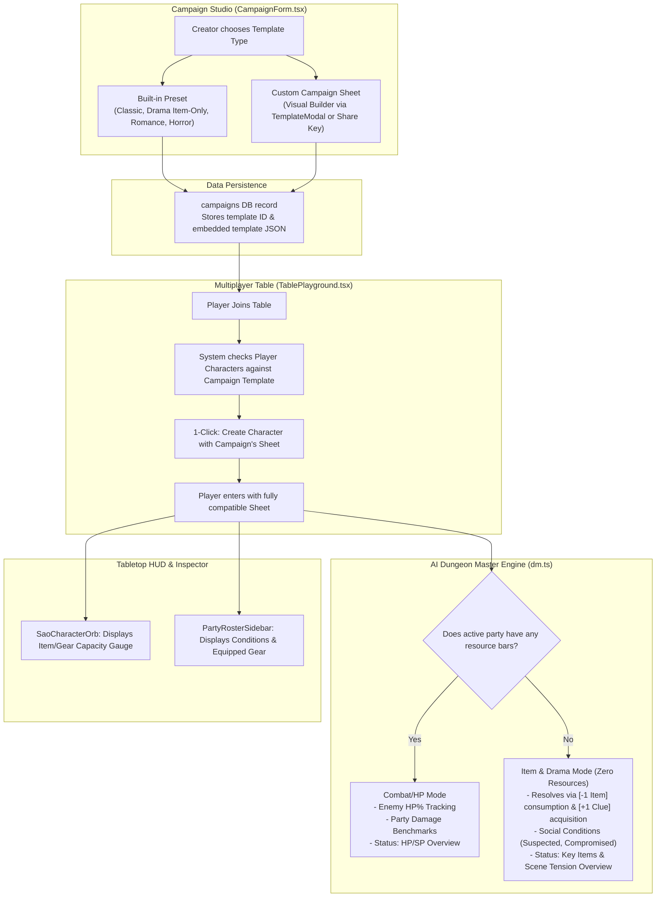

# Implementation Plan: Campaign-Required Character Sheet Templates & Zero-Resource Gameplay

> **Objective:** Require every campaign to enforce a specific Character Sheet Template (Built-in Preset or Custom Template) while eliminating the "Any Template" option. Support non-combat, item-driven genres (such as Drama, Mystery, Escape Room, and Social Intrigue) that operate with **zero resource bars (no HP/SP)**, relying entirely on inventory items, equipment/disguises, and social conditions.

---

## 1. System Architecture & Flow



---

## 2. Component Breakdown

### Phase 1: Drama & Inventory-Only Built-in Template
**File:** `src/features/character/template.ts`

1. Add `DRAMA_INVENTORY_TEMPLATE`:
   - `id: 'builtin-drama-inventory'`
   - `name: 'Drama & Mystery (Inventory & Clues Only)'`
   - `description: 'Narrative social intrigue and mystery. No HP or SP bars. Conflict is resolved through items, clues, disguises, and social conditions.'`
   - `resources: []` *(Empty array — 0 resource bars!)*
   - `stats: [ { id: 'reputation', label: 'Reputation / Clout (บารมี)' }, { id: 'composure', label: 'Composure (ความนิ่ง)' }, { id: 'subterfuge', label: 'Subterfuge (เล่ห์เหลี่ยม)' } ]`
   - `equipmentSlots: [ { id: 'outfit', label: 'Attire / Disguise (ชุดที่สวม/เครื่องแบบ)' }, { id: 'pocket', label: 'Pockets (ของพกติดตัว/กระเป๋าเสื้อ)' }, { id: 'bag', label: 'Bag / Briefcase (กระเป๋าถือ/เป้)' }, { id: 'accessory', label: 'Keepsake / Badge (ตราประจำตัว/ของนำโชค)' } ]`
   - `conditions: ['Normal', 'Suspected', 'Favored', 'Blackmailed', 'Compromised', 'Exiled']`
   - `sections: { skills: false, inventory: true }`
2. Update `BUILTIN_TEMPLATES`:
   - Include `DRAMA_INVENTORY_TEMPLATE`.
3. Add Campaign Template Helper Functions:
   - `readCampaignTemplate(campaign: CampaignLike): CharacterTemplate`
   - `packCampaignTemplate(template: CharacterTemplate, ruleMechanics: string): { ruleMechanics: string, templateId: string }`

---

### Phase 2: Campaign Studio Sheet Selector
**Files:**
- `src/features/campaign/components/CampaignForm.tsx`
- `src/features/campaign/actions.ts`

1. **Remove the "Any Template" option completely**:
   - Every campaign **must** declare its required character sheet template.
2. **Template Selection UI in `CampaignForm.tsx`**:
   - **Type A: Built-in Presets** (Radio / Card selector):
     - `Classic Fantasy RPG` (HP, SP, 6 ability scores, gear, skills, inventory)
     - `Drama & Mystery` (0 resource bars, inventory & equipment only, social intrigue)
     - `Romance / Slice of Life` (Heart, Stress, charms, keepsakes)
     - `Horror Investigation` (HP, Sanity, Luck, pocket, clothing)
   - **Type B: Custom Campaign Template**:
     - Toggle to "Custom Template".
     - Button: **"Customize Template / Import Share Key"** opens `TemplateModal.tsx`.
     - Allows DM to customize stats, remove all resources for item-only play, customize equipment slots (e.g. `Holster`, `Tool belt`, `Badge`), and define custom conditions.
     - Supports pasting an exported Template Share Key or JSON.
     - Live preview card displays summary (e.g. `Custom: "1920s Noir" • 0 Resources • 4 Slots • 3 Stats`).
3. **Database Persistence**:
   - Embed and persist the template cleanly in `campaigns` so every player and table joining this campaign automatically inherits the exact template definition.

---

### Phase 3: Table Playground Player Onboarding & Enforcement
**File:** `src/features/table/components/TablePlayground.tsx`

1. **Compatibility Inspection**:
   - Compare player's character `sheetTemplate.id` against the table's `campaignTemplate.id`.
   - In the Character Selection Drawer:
     - Mark compatible characters with a badge: `✓ Matches Campaign Template`.
     - Incompatible characters are grayed out or marked: `Sheet Template Mismatch`.
2. **1-Click Character Creator**:
   - Provide a prominent button: **"Create Character for this Campaign"**.
   - Opens the character creator with the campaign's template **pre-loaded** (matching slots, stats, and zero-resource configuration).

---

### Phase 4: AI DM Zero-Resource & Item-Driven Mode
**File:** `src/lib/ai/dm.ts`

1. **Check Party Resource Presence**:
   - `const hasAnyResources = partyActions.some(m => getMemberResourceDescriptors(m).length > 0)`
2. **Conditional System Directives**:
   - **When `hasAnyResources === true`**:
     - Retain combat rules (Rule 4 Enemy HP %, Rule 5 Party Damage Benchmark).
   - **When `hasAnyResources === false` (Zero Resource / Drama Mode)**:
     - **Disable Rule 4 & 5**: Do not calculate damage benchmarks; do not enforce monster HP percentages.
     - **Inject Item & Social Directives**:
       - Conflicts are resolved through **Item Usage**, **Item Consumption/Depletion** (`[-1 Flashlight Battery]`), **Item Acquisition** (`[+1 Secret Ledger]`), **Equipment State/Disguises**, and **Social Conditions** (`Suspected`, `Compromised`).
       - If an action uses an item in inventory: describe whether the item was expended, damaged, or successful.
3. **Dynamic `[ Overview ]` Schema**:
   - If `hasAnyResources === false`, format the overview block as:
     ```text
     [ Overview ]
     สิ่งของสำคัญและเบาะแสที่ปาร์ตี้ถืออยู่ : [รายการของสำคัญในมือ/กระเป๋า]
     สถานการณ์และความตึงเครียดของฉาก : [ระดับความตึงเครียด หรือความคืบหน้าของเงื่อนงำ]
     สถานะตัวละคร : [ชื่อ]: [สถานะผิดปกติปัจจุบัน]
     ```

---

### Phase 5: Automatic Item & Condition Sync
**File:** `src/features/table/actions.ts`

1. Extend `extractPartyStateUpdates`:
   - Parse item additions: `ได้รับ [ชื่อไอเทม]` or `[+1 ชื่อไอเทม]` $\rightarrow$ Append item to `character.inventory`.
   - Parse item removals: `สูญเสีย [ชื่อไอเทม]` or `[-1 ชื่อไอเทม]` $\rightarrow$ Decrement or remove item from `character.inventory`.
   - Sync condition changes (`status_condition`).

---

### Phase 6: HUD & UI Polishing for Zero-Resource Sheets
**Files:**
- `src/features/table/components/SaoCharacterOrb.tsx`
- `src/features/table/components/PartyRosterSidebar.tsx`

1. **`SaoCharacterOrb.tsx`**:
   - When `resolvedResources.length === 0`:
     - Render the upper semicircle as an **Inventory Capacity & Equipped Gear Gauge** (e.g. `Items: 4/10` or equipped slot count) in vibrant amber/cyan neon styling, rather than showing a blank or disabled arc.
2. **`PartyRosterSidebar.tsx`**:
   - When a character has no resource bars:
     - Instead of showing empty red HP bars, render clean tags for **Active Condition** (e.g. `[Suspected]`) and primary equipped gear (e.g. `[Trench Coat]`).

---

## 3. Implementation Steps Order

| Step | Action | Impacted Files |
| :---: | :--- | :--- |
| **1** | Define `DRAMA_INVENTORY_TEMPLATE` and campaign template helpers | `src/features/character/template.ts` |
| **2** | Add Campaign Template Selector & integrate `TemplateModal` | `src/features/campaign/components/CampaignForm.tsx`, `actions.ts` |
| **3** | Update Table Playground for template compatibility, polite mismatch comparison popup, 1-click sheet creation & full-web validation | `src/features/table/components/TablePlayground.tsx`, `CharacterInspectorPanel.tsx`, `actions.ts`, `CampaignForm.tsx`, `CharacterEditor.tsx`, `HubClient.tsx`, `AlertModal.tsx` |
| **4** | Adapt AI DM system instructions & `[ Overview ]` for zero-resource mode | `src/lib/ai/dm.ts` |
| **5** | Add automatic item grant/depletion parsing to `extractPartyStateUpdates` | `src/features/table/actions.ts` |
| **6** | Update SAO Character Orb & Roster Sidebar to render inventory/gear for 0-resource sheets | `src/features/table/components/SaoCharacterOrb.tsx`, `PartyRosterSidebar.tsx` |
| **7** | Typecheck (`tsc --noEmit`), lint (`eslint src`), and production build (`bun run build`) | Workspace verification |

---

## 4. Verification & Testing Checklist

- [x] **Campaign Creation & Custom Blank Sheet Canvas**:
  - Create a campaign with `Classic Fantasy RPG` preset.
  - Create a campaign with `Drama & Mystery (Inventory Only)` preset.
  - Create a campaign with a **Custom Template** starting from a 100% clean blank canvas (`createEmptyTemplate` with 0 resources, 0 stats, 0 slots).
  - Quick "ล้างเป็นชีทว่าง (Start from Blank)" actions in Campaign Studio and TemplateModal.
- [x] **Table Onboarding & Template Synchronization**:
  - Enter a table and verify character compatibility checks.
  - Notice banner and 1-click button for players who have no compatible characters.
  - "สร้างตัวละครจากเทมเพลตที่แคมเปญกำหนด" button automatically fetches and loads the campaign's custom template (`getCampaignRequiredTemplate`) in Character Codex.
  - Pre-populates the new character draft and auto-returns to table upon saving.
  - Server validation in `linkCharacterToTable` strictly blocks mismatched sheets.
- [ ] **Zero-Resource Narrative Test**:
  - Trigger a turn in a Drama table where characters have 0 resource bars.
  - Verify AI DM output does NOT mention HP damage or enemy HP%.
  - Verify AI DM outputs item consumption/acquisition and tension overview.
  - Verify inventory and conditions auto-sync correctly to Supabase.
- [ ] **HUD & Dial Visuals**:
  - Verify `SaoCharacterOrb` displays the Item/Gear gauge cleanly without layout glitches.
  - Verify `PartyRosterSidebar` renders condition badges gracefully.
