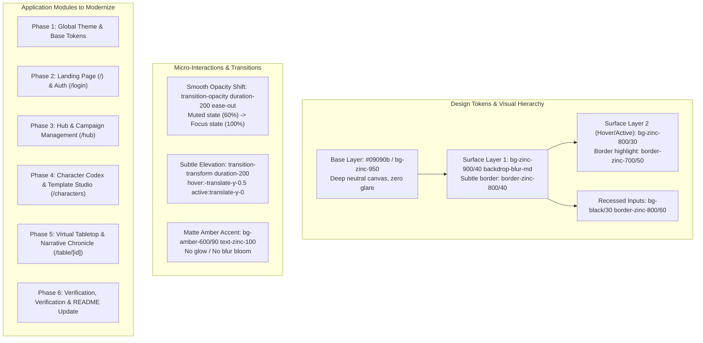

# Implementation Plan: Sitewide Modern Minimalist UI Redesign (Smooth Fade & Opacity Architecture)

> **Objective:** Modernize the entire user interface of TofuTablePlay into a clean, sleek, distraction-free "Modern Minimalist Dark / Swiss Dark" design system. The aesthetic strictly avoids harsh glowing lights, bloom, and neon effects, and instead leverages **layered opacity surfaces (`backdrop-blur-md`, subtle alpha channels)**, **smooth fade micro-interactions**, **matte amber accents**, and **refined typography & spacing**.
>
> **Status:** Draft / Ready for Execution

---

## 1. Design System & Philosophy: "Smooth Fade & Layered Opacity"

### 1.1 Visual Token Reference
- **Surfaces**:
  - `Base`: `bg-zinc-950`
  - `Card / Panel`: `bg-zinc-900/40 backdrop-blur-md border border-zinc-800/50`
  - `Card Hover`: `hover:bg-zinc-800/30 hover:border-zinc-700/60 transition-all duration-200 ease-out`
  - `Modals / Drawers`: `bg-zinc-900/90 backdrop-blur-xl border border-zinc-800/80 shadow-2xl shadow-black/80`
  - `Input Fields`: `bg-black/30 border border-zinc-800/70 focus:border-zinc-600 focus:bg-black/50 transition-colors`
- **Text & Typography Hierarchy**:
  - `Primary / Titles`: `text-zinc-100 font-semibold tracking-tight`
  - `Body / Story`: `text-zinc-300 text-sm leading-relaxed`
  - `Secondary / Subtitles`: `text-zinc-400 text-xs`
  - `Metadata / Timestamps`: `text-zinc-500 text-xs font-mono`
- **Accents (Matte & Faded)**:
  - `Primary Action`: `bg-amber-600/90 hover:bg-amber-600 active:bg-amber-700 text-zinc-100 font-medium rounded-lg`
  - `Secondary Action`: `bg-zinc-900/60 hover:bg-zinc-800/70 border border-zinc-800/60 text-zinc-300`
  - `Subtle Badge`: `bg-amber-500/10 border border-amber-500/20 text-amber-400/90 rounded-full px-2.5 py-0.5 text-xs`

---

## 2. Phased Implementation Roadmap

### Phase 1: Global Styling & Foundations
- [x] **1.1 Global CSS & Layout Polish** (`src/app/globals.css`, `src/app/layout.tsx`):
  - Add refined custom dark scrollbars (`scrollbar-thin`, thumb: `zinc-800`, hover: `zinc-700`).
  - Configure sleek selection style (`selection:bg-zinc-800 selection:text-amber-300`).
  - Standardize base layout background and font rendering smoothing (`antialiased`).
  - Added reusable surface utilities (`.surface-panel`, `.surface-panel-hover`, `.fade-mask-y`).
  - Created dedicated `website_ui.md` design system documentation.
  - Verified 0 TypeScript errors and 0 ESLint warnings.

---

### Phase 2: Landing Page & Authentication
- [x] **2.1 Landing Page Redesign** (`src/app/page.tsx`):
  - Replace stark black layout with a sleek layered opacity hero.
  - Add `LanguageToggle` directly to Landing header.
  - Refactor feature cards into clean `.surface-panel` frosted panels with smooth hover transitions.
  - Created interactive "Live Story Preview" mock card showing an excerpt of DM narration and party status with smooth opacity badges.
  - Added bilingual EN/TH support across the landing page.
- [x] **2.2 Login & Registration Screen** (`src/app/login/page.tsx`):
  - Redesigned into a modern floating glass card (`surface-panel` with `backdrop-blur-xl`).
  - Added header with `LanguageToggle` and return link.
  - Recessed inputs (`bg-black/40 border-zinc-800/80`) and matte amber button.
  - Smooth opacity transitions for form fields, error badges, and toggle links.
  - Verified with 0 TypeScript errors and 0 ESLint warnings.

---

### Phase 3: Hub & Campaign Management
- [ ] **3.1 Hub Header & Navigation** (`src/features/hub/components/HubHeader.tsx`):
  - Floating translucent header bar with refined action buttons and clear hierarchy.
- [ ] **3.2 Active Tables & Campaign Card Grid** (`src/features/hub/components/HubClient.tsx`):
  - Redesign active table chips with soft pulsing green dots and copyable invite link pills.
  - Redesign campaign cards with smooth elevation (`hover:-translate-y-0.5`), author chips, and subtle category badges.
  - Modernize search bar and category filter tabs with sleek pill navigation.
- [ ] **3.3 Campaign Creation & Details** (`src/features/campaign/...`):
  - Refactor `CampaignForm.tsx` and `CampaignDetailsClient.tsx` with clean card sections and subtle border dividers.

---

### Phase 4: Character Codex & Template Studio
- [ ] **4.1 Codex Header & Character Roster** (`src/features/character/...`):
  - Redesign character card list with matte archetype tags, stat summary pills, and delete/edit buttons with smooth fade opacity.
- [ ] **4.2 Character Sheet Editor** (`CharacterEditor.tsx`):
  - Clean tabbed interface for Stats, Inventory, Spells/Skills, and Background.
  - Matte resource counters (HP/SP) with subtle level indicators.
- [ ] **4.3 Template Studio Modal** (`TemplateModal.tsx`):
  - Sleek modal backdrop (`bg-black/60 backdrop-blur-sm`).
  - Refined template cards with subtle hover opacity borders.

---

### Phase 5: Virtual Tabletop (VTT) & In-Table HUD
- [ ] **5.1 Table Top Layout & Header** (`src/features/table/components/TablePlayground.tsx`):
  - Minimalist top bar with campaign title, turn phase pill, and countdown timer.
- [ ] **5.2 Narrative Chronicle** (`NarrativeFeedPanel.tsx`):
  - Smooth scroll with top/bottom fade mask so text gently emerges and recedes.
  - Clean turn divider bars and DM narration blocks with high typography legibility.
- [ ] **5.3 SAO Character Orb & Party Roster** (`SaoCharacterOrb.tsx`, `PartyRosterSidebar.tsx`):
  - Refine dial arcs into modern matte status gauges without glare.
  - Floating action drawer with smooth slide and fade transitions.
- [ ] **5.4 3D Dice Tray & Chat Widget** (`DiceRoller.tsx`, `PartyChatWidget.tsx`):
  - Frosted translucent chat bubble and dice roller modal with smooth fade backdrop.

---

### Phase 6: Quality Assurance, Verification & Documentation
- [ ] **6.1 Type & Lint Verification**:
  - Run `npx tsc --noEmit` and ensure 0 TypeScript errors.
  - Run `npx eslint src` and ensure 0 warnings/errors.
- [ ] **6.2 Bilingual Compatibility Check**:
  - Ensure all modernized components seamlessly maintain English and Thai translations via `useLanguage()`.
- [ ] **6.3 Documentation Update**:
  - Update `README.md` with the new design system guidelines, updated screenshots/descriptions, and ASCII tree.

---

## 3. Verification Criteria & Testing Checklist
- [ ] **Zero Glare / No Glowing Light Blooms**: No neon text-shadows, radial blur blobs, or saturated colored shadows.
- [ ] **Consistent Opacity Hierarchy**: Cards use `bg-zinc-900/40`, borders use `border-zinc-800/50`, muted text uses `text-zinc-400`/`text-zinc-500`.
- [ ] **Smooth Transitions**: All hover and interactive states use `transition-all duration-200 ease-out` or `transition-opacity`.
- [ ] **Accessibility & Contrast**: All body text retains high contrast against dark surfaces (meeting WCAG AA standards).
- [ ] **Clean Codebase**: 0 TypeScript compilation errors, 0 ESLint warnings.
