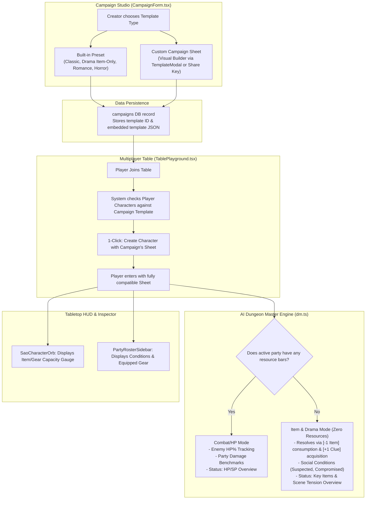

# Implementation Plan: Campaign-Required Character Sheet Templates & Zero-Resource Gameplay

> **Objective:** Require every campaign to enforce a specific Character Sheet Template (Built-in Preset or Custom Template) while eliminating the "Any Template" option. Support non-combat, item-driven genres (such as Drama, Mystery, Escape Room, and Social Intrigue) that operate with **zero resource bars (no HP/SP)**, relying entirely on inventory items, equipment/disguises, and social conditions.

---

## 1. System Architecture & Flow



---

## 2. Component Breakdown

### Phase 1: Drama & Inventory-Only Built-in Template
**File:** `src/features/character/template.ts`

1. Add `DRAMA_INVENTORY_TEMPLATE`:
   - `id: 'builtin-drama-inventory'`
   - `name: 'Drama & Mystery (Inventory & Clues Only)'`
   - `description: 'Narrative social intrigue and mystery. No HP or SP bars. Conflict is resolved through items, clues, disguises, and social conditions.'`
   - `resources: []` *(Empty array — 0 resource bars!)*
   - `stats: [ { id: 'reputation', label: 'Reputation / Clout (บารมี)' }, { id: 'composure', label: 'Composure (ความนิ่ง)' }, { id: 'subterfuge', label: 'Subterfuge (เล่ห์เหลี่ยม)' } ]`
   - `equipmentSlots: [ { id: 'outfit', label: 'Attire / Disguise (ชุดที่สวม/เครื่องแบบ)' }, { id: 'pocket', label: 'Pockets (ของพกติดตัว/กระเป๋าเสื้อ)' }, { id: 'bag', label: 'Bag / Briefcase (กระเป๋าถือ/เป้)' }, { id: 'accessory', label: 'Keepsake / Badge (ตราประจำตัว/ของนำโชค)' } ]`
   - `conditions: ['Normal', 'Suspected', 'Favored', 'Blackmailed', 'Compromised', 'Exiled']`
   - `sections: { skills: false, inventory: true }`
2. Update `BUILTIN_TEMPLATES`:
   - Include `DRAMA_INVENTORY_TEMPLATE`.
3. Add Campaign Template Helper Functions:
   - `readCampaignTemplate(campaign: CampaignLike): CharacterTemplate`
   - `packCampaignTemplate(template: CharacterTemplate, ruleMechanics: string): { ruleMechanics: string, templateId: string }`

---

### Phase 2: Campaign Studio Sheet Selector
**Files:**
- `src/features/campaign/components/CampaignForm.tsx`
- `src/features/campaign/actions.ts`

1. **Remove the "Any Template" option completely**:
   - Every campaign **must** declare its required character sheet template.
2. **Template Selection UI in `CampaignForm.tsx`**:
   - **Type A: Built-in Presets** (Radio / Card selector):
     - `Classic Fantasy RPG` (HP, SP, 6 ability scores, gear, skills, inventory)
     - `Drama & Mystery` (0 resource bars, inventory & equipment only, social intrigue)
     - `Romance / Slice of Life` (Heart, Stress, charms, keepsakes)
     - `Horror Investigation` (HP, Sanity, Luck, pocket, clothing)
   - **Type B: Custom Campaign Template**:
     - Toggle to "Custom Template".
     - Button: **"Customize Template / Import Share Key"** opens `TemplateModal.tsx`.
     - Allows DM to customize stats, remove all resources for item-only play, customize equipment slots (e.g. `Holster`, `Tool belt`, `Badge`), and define custom conditions.
     - Supports pasting an exported Template Share Key or JSON.
     - Live preview card displays summary (e.g. `Custom: "1920s Noir" • 0 Resources • 4 Slots • 3 Stats`).
3. **Database Persistence**:
   - Embed and persist the template cleanly in `campaigns` so every player and table joining this campaign automatically inherits the exact template definition.

---

### Phase 3: Table Playground Player Onboarding & Enforcement
**File:** `src/features/table/components/TablePlayground.tsx`

1. **Compatibility Inspection**:
   - Compare player's character `sheetTemplate.id` against the table's `campaignTemplate.id`.
   - In the Character Selection Drawer:
     - Mark compatible characters with a badge: `✓ Matches Campaign Template`.
     - Incompatible characters are grayed out or marked: `Sheet Template Mismatch`.
2. **1-Click Character Creator**:
   - Provide a prominent button: **"Create Character for this Campaign"**.
   - Opens the character creator with the campaign's template **pre-loaded** (matching slots, stats, and zero-resource configuration).

---

### Phase 4: AI DM Zero-Resource & Item-Driven Mode
**File:** `src/lib/ai/dm.ts`

1. **Check Party Resource Presence**:
   - `const hasAnyResources = partyActions.some(m => getMemberResourceDescriptors(m).length > 0)`
2. **Conditional System Directives**:
   - **When `hasAnyResources === true`**:
     - Retain combat rules (Rule 4 Enemy HP %, Rule 5 Party Damage Benchmark).
   - **When `hasAnyResources === false` (Zero Resource / Drama Mode)**:
     - **Disable Rule 4 & 5**: Do not calculate damage benchmarks; do not enforce monster HP percentages.
     - **Inject Item & Social Directives**:
       - Conflicts are resolved through **Item Usage**, **Item Consumption/Depletion** (`[-1 Flashlight Battery]`), **Item Acquisition** (`[+1 Secret Ledger]`), **Equipment State/Disguises**, and **Social Conditions** (`Suspected`, `Compromised`).
       - If an action uses an item in inventory: describe whether the item was expended, damaged, or successful.
3. **Dynamic `[ Overview ]` Schema**:
   - If `hasAnyResources === false`, format the overview block as:
     ```text
     [ Overview ]
     สิ่งของสำคัญและเบาะแสที่ปาร์ตี้ถืออยู่ : [รายการของสำคัญในมือ/กระเป๋า]
     สถานการณ์และความตึงเครียดของฉาก : [ระดับความตึงเครียด หรือความคืบหน้าของเงื่อนงำ]
     สถานะตัวละคร : [ชื่อ]: [สถานะผิดปกติปัจจุบัน]
     ```

---

### Phase 5: Automatic Item & Condition Sync
**File:** `src/features/table/actions.ts`

1. Extend `extractPartyStateUpdates`:
   - Parse item additions: `ได้รับ [ชื่อไอเทม]` or `[+1 ชื่อไอเทม]` $\rightarrow$ Append item to `character.inventory`.
   - Parse item removals: `สูญเสีย [ชื่อไอเทม]` or `[-1 ชื่อไอเทม]` $\rightarrow$ Decrement or remove item from `character.inventory`.
   - Sync condition changes (`status_condition`).

---

### Phase 6: HUD & UI Polishing for Zero-Resource Sheets
**Files:**
- `src/features/table/components/SaoCharacterOrb.tsx`
- `src/features/table/components/PartyRosterSidebar.tsx`

1. **`SaoCharacterOrb.tsx`**:
   - When `resolvedResources.length === 0`:
     - Render the upper semicircle as an **Inventory Capacity & Equipped Gear Gauge** (e.g. `Items: 4/10` or equipped slot count) in vibrant amber/cyan neon styling, rather than showing a blank or disabled arc.
2. **`PartyRosterSidebar.tsx`**:
   - When a character has no resource bars:
     - Instead of showing empty red HP bars, render clean tags for **Active Condition** (e.g. `[Suspected]`) and primary equipped gear (e.g. `[Trench Coat]`).

---

## 3. Implementation Steps Order

| Step | Action | Impacted Files |
| :---: | :--- | :--- |
| **1** ✅ | Define `DRAMA_INVENTORY_TEMPLATE` and campaign template helpers | `src/features/character/template.ts` |
| **2** ✅ | Add Campaign Template Selector & integrate `TemplateModal` | `src/features/campaign/components/CampaignForm.tsx`, `actions.ts` |
| **3** ✅ | Update Table Playground for template compatibility, polite mismatch comparison popup, 1-click sheet creation & full-web validation | `src/features/table/components/TablePlayground.tsx`, `CharacterInspectorPanel.tsx`, `actions.ts`, `CampaignForm.tsx`, `CharacterEditor.tsx`, `HubClient.tsx`, `AlertModal.tsx` |
| **4** | Adapt AI DM system instructions & `[ Overview ]` for zero-resource mode | `src/lib/ai/dm.ts` |
| **5** | Add automatic item grant/depletion parsing to `extractPartyStateUpdates` | `src/features/table/actions.ts` |
| **6** | Update SAO Character Orb & Roster Sidebar to render inventory/gear for 0-resource sheets | `src/features/table/components/SaoCharacterOrb.tsx`, `PartyRosterSidebar.tsx` |
| **7** | Typecheck (`tsc --noEmit`), lint (`eslint src`), and production build (`bun run build`) | Workspace verification |

---

## 4. Verification & Testing Checklist

- [x] **Campaign Creation & Custom Blank Sheet Canvas**:
  - Create a campaign with `Classic Fantasy RPG` preset.
  - Create a campaign with `Drama & Mystery (Inventory Only)` preset.
  - Create a campaign with a **Custom Template** starting from a 100% clean blank canvas (`createEmptyTemplate` with 0 resources, 0 stats, 0 slots).
  - Quick "ล้างเป็นชีทว่าง (Start from Blank)" actions in Campaign Studio and TemplateModal.
- [x] **Table Onboarding & Template Synchronization**:
  - Enter a table and verify character compatibility checks.
  - Notice banner and 1-click button for players who have no compatible characters.
  - "สร้างตัวละครจากเทมเพลตที่แคมเปญกำหนด" button automatically fetches and loads the campaign's custom template (`getCampaignRequiredTemplate`) in Character Codex.
  - Pre-populates the new character draft and auto-returns to table upon saving.
  - Server validation in `linkCharacterToTable` strictly blocks mismatched sheets.
- [ ] **Zero-Resource Narrative Test**:
  - Trigger a turn in a Drama table where characters have 0 resource bars.
  - Verify AI DM output does NOT mention HP damage or enemy HP%.
  - Verify AI DM outputs item consumption/acquisition and tension overview.
  - Verify inventory and conditions auto-sync correctly to Supabase.
- [ ] **HUD & Dial Visuals**:
  - Verify `SaoCharacterOrb` displays the Item/Gear gauge cleanly without layout glitches.
  - Verify `PartyRosterSidebar` renders condition badges gracefully.


---
---

# Part 2: AI DM Template-Awareness & Character Sheet Architecture Audit

> **Source:** Code audit of `src/lib/ai/dm.ts`, `src/features/character/template.ts`, `src/features/character/actions.ts` (2026-10-28).
> **Status:** Audit only — no code changed yet.
> **Relationship to Part 1:** Phase B below **supersedes Part 1 Phase 4** (zero-resource AI mode) with a more general design; Phase C **supersedes Part 1 Phase 5** (item/condition regex parsing) by replacing regex with structured JSON output. Part 1 Phase 6 (HUD) remains valid.

---

## 5. Audit Findings

### 5.1 Does the AI reply adapt to template parameters?

**Partially.** Labels adapt; rules do not.

| Adapts per template ✅ | Hardcoded for every campaign ❌ |
| :--- | :--- |
| Resource names (HP / Heart / Sanity / Stress) | Enemy HP % tracking & "no one-shot kills" (Rule 4) |
| Stat labels used in `[ Decision ]` | Shared flat damage benchmark & "no plot armor" (Rule 5) |
| Allowed conditions & equipment slot names | `d20 + stat vs DC` resolution |
| `[ Overview ]` party-status example line | `[ Overview ]` always asks for `สถานะศัตรู` |
| Damage benchmark from party avg Max HP | D&D modifier formula `(score − 10) / 2` |
| Skills / inventory only if section enabled | Thai → English condition map targets Classic conditions |

Result: a Romance or Drama campaign is still instructed to run combat and compute damage.

### 5.2 Issues

| # | Severity | Issue | Location |
| :-: | :-: | :--- | :--- |
| 1 | 🔴 Bug | 0-resource templates are silently re-filled with Classic HP/Skill Cost: `tpl.resources.length > 0 ? tpl.resources : CLASSIC_TEMPLATE.resources`. Drama characters show HP to the AI and receive damage. | `src/lib/ai/dm.ts` L101–105 (`getMemberResourceDescriptors`) |
| 2 | 🔴 Bug | Campaign template is packed as `<!-- CAMPAIGN_TEMPLATE: {...JSON} -->` inside `rule_mechanics`, but `generateDmNarrative` (L559) and `generateOpeningNarrative` (L1148) inject `campaign.rule_mechanics` raw → full template JSON leaks into `[ACTIVE MECHANICS / RULES]` every turn (wasted tokens, possible confusion). Same for `boardDm.ts` L64. | `dm.ts`, `boardDm.ts`, `template.ts` L552–560 |
| 3 | 🟠 | `abilityModifier` assumes D&D 3–20 scale. Custom templates with 1–5 or 0–100 scales get nonsensical modifiers in prompt & `DiceRoller`. | `components/dice/dice.ts`, `dm.ts` |
| 4 | 🟠 | Campaign template lookup by `ilike('rule_mechanics', '%"id":"..."%')` — slow full-text scan, fragile. | `src/features/character/actions.ts` L186–190 |
| 5 | 🟡 | Party state sync relies on regex over Thai prose (`(ชื่อ — HP: a/b -> c/b)`, `สถานะปาร์ตี้ :`), alias tables, and Thai→English condition map. Any formatting drift by the model = missed update. | `extractPartyStateUpdates` in `dm.ts` |
| 6 | 🟡 | Dual storage model: Classic values live in legacy columns (`current_hp`, `stats.STR`, `equipment[0..5]`, `appearance`…) while custom values live in `stats.sheet_custom`. Every consumer branches on `isColumnStatId` / `isColumnTextFieldId` / `COLUMN_EQUIPMENT_SLOT_INDEX`. | project-wide |
| 7 | 🟡 | Each character embeds a full template snapshot in `stats.sheet_template`. When a GM edits the campaign template, existing characters drift; compatibility must compare structure field-by-field. | `characters.stats` |
| 8 | ⚪ | `armor_class` column is no longer used by templates. | `characters` table |

### 5.3 Verdict on current Character Sheet structure

**Functionally correct** (strict TypeScript, sanitized input, backward-compatible), but it is a **transitional hybrid**, not an ideal long-term model (issues 2, 4, 6, 7).

---

## 6. Phase A — Critical Bug Fixes (small, do first)

**Files:** `src/lib/ai/dm.ts`, `src/lib/ai/boardDm.ts`

1. **Remove Classic fallback for 0-resource templates**
   - `getMemberResourceDescriptors`: use `tpl.resources` as-is (only fall back to Classic when `sheetTemplate` itself is missing).
   - `computePartyDamageBenchmark`: ignore members without a vitality resource; if nobody has one, return `null` and skip damage rules.
   - `formatPartyMemberForPrompt`: omit the Resources and Defense Mitigation lines when the member has no resources.
   - `[ Overview ]` example: show only `ชื่อ: สถานะ: X` for 0-resource members.
2. **Strip packed template from rules before prompting**
   - Wrap with `stripCampaignTemplateFromRules(campaign.rule_mechanics)` in `generateDmNarrative`, `generateOpeningNarrative`, and `boardDm.ts`.
3. **Verify:** Drama table turn → prompt contains no `HP`, no `<!-- CAMPAIGN_TEMPLATE`, no damage benchmark.

---

## 7. Phase B — Template-Driven Rules Profile (replaces Part 1 Phase 4)

**Files:** `template.ts`, `TemplateModal.tsx`, `dm.ts`, `dice.ts`, `DiceRoller.tsx`

1. **Extend `CharacterTemplate` with `mechanics`** (bump `TEMPLATE_SCHEMA_VERSION`, sanitizer defaults for old templates):
   ```ts
   mechanics: {
     mode: 'combat' | 'narrative' | 'social' | 'horror'
     vitalityResourceId: string | null   // null = no damage system
     dice: 'd20' | '2d6' | 'd100' | 'none'
     statModifier: 'dnd' | 'raw' | 'none' // dnd = (s-10)/2, raw = +score
   }
   ```
   - Presets: Classic `combat/hp/d20/dnd`, Horror `horror/hp/d20/dnd`, Romance `social/hp(Heart)/d20/raw`, Drama `narrative/null/d20/raw`.
   - Old/custom templates without `mechanics`: infer (`resources.length === 0` → `narrative/null`).
2. **Expose in `TemplateModal`** — a "Rules / กติกา" section with mode, vitality resource picker, dice, modifier style.
3. **Modular system instruction in `dm.ts`**
   - Split current rules into modules: `CORE` (continuity, anti-repetition, no-action handling), `COMBAT` (Rules 4–5), `SOCIAL` (relationships, reputation, tension), `NARRATIVE_ITEMS` (item use/consume/acquire, clues), `HORROR` (sanity/fear pacing).
   - Compose by party modes: include `COMBAT` only if any member has `vitalityResourceId`.
   - Dynamic `[ Overview ]` schema per mode (e.g. narrative: `สิ่งของสำคัญและเบาะแส`, `ความตึงเครียดของฉาก`, `สถานะตัวละคร`; omit `สถานะศัตรู` when no combat).
   - `[ Decision ]` dice expression from `mechanics.dice`; omit when `dice: 'none'`.
4. **Modifier formula** — `abilityModifier(score, mechanics.statModifier)` used by prompt and `DiceRoller`.
5. **Mixed-template parties** — union of modules; per-member rules stated in each member block.

---

## 8. Phase C — Structured JSON AI Output (replaces Part 1 Phase 5)

**Files:** `dm.ts`, `table/actions.ts`, `NarrativeFeedPanel.tsx`, `turns` table

1. **Use Gemini structured output** (`responseMimeType: 'application/json'` + `responseSchema`), mirroring the existing approach in `boardDm.ts`:
   ```ts
   {
     narration: string,
     overview: {
       location: string, time: string, situation: string,
       enemies: { name: string, hpPercent: number }[],   // empty when no combat
       keyItems?: string[], tension?: string              // narrative mode
     },
     partyUpdates: {
       characterId: string,
       resources: Record<string, { current: number, max: number }>,
       condition: string,
       inventoryAdd?: { name: string, quantity: number }[],
       inventoryRemove?: { name: string, quantity: number }[]
     }[],
     decisions: { characterId: string, prompt: string, statId: string, dc: number }[]
   }
   ```
2. **Server-side validation** — clamp resources to `[0, max]`, only accept `resourceId`s in the member's template, only accept conditions in `tpl.conditions`, ignore unknown `characterId`s.
3. **Rendering** — `NarrativeFeedPanel` renders `[ Overview ]` / `[ Decision ]` cards from structured data; store JSON in new `turns.structured_output jsonb` alongside `narrative_output` (narration text) for history.
4. **Fallback** — on JSON parse failure, keep current regex `extractPartyStateUpdates` path for one release, then remove alias tables / Thai condition map.
5. **History window** — feed previous turns' `overview` JSON back so enemy HP% / tension continuity is exact.

---

## 9. Phase D — Database Restructure (large, needs migration)

**Files:** Supabase migrations, `character/actions.ts`, `campaign/actions.ts`, `table/actions.ts`, `template.ts`, `CharacterEditor.tsx`, `dm.ts`

1. **New schema**
   ```text
   character_templates (id uuid, owner_id, name, version int, schema jsonb, hash text, created_at)
   campaigns.template_id          → FK character_templates (or builtin id)
   characters.template_id         → FK
   characters.template_version    int
   characters.sheet               jsonb  -- { resources, stats, fields, equipment } keyed by template ids
   ```
   - Optional generated columns (e.g. `hp_current`) only if queries need them.
2. **Migration script**
   - Extract `<!-- CAMPAIGN_TEMPLATE -->` from every `campaigns.rule_mechanics` → insert `character_templates`, set `campaigns.template_id`, strip marker.
   - Fold legacy columns (`current_hp`, `max_hp`, `stats.STR…`, `equipment[]`, `appearance`, `backstory`, `strengths`, `weaknesses`) + `stats.sheet_custom` into `characters.sheet`.
   - Deduplicate `stats.sheet_template` snapshots into `character_templates` by `hash`.
3. **Code simplification** — delete `isColumnStatId`, `isColumnTextFieldId`, `COLUMN_EQUIPMENT_SLOT_INDEX`, `packCampaignTemplateIntoRules`, `CAMPAIGN_TEMPLATE_COMMENT_REGEX`, `ilike` lookup.
4. **Compatibility** — `character.template_id === campaign.template_id` (+ version check) instead of structural comparison.
5. **Template versioning** — editing a campaign template creates a new version; characters on older versions get an "อัปเกรดชีท (Upgrade Sheet)" action that maps matching ids and fills defaults.
6. **Cleanup** — drop `armor_class` and legacy columns after one release with read-compat.

---

## 10. Updated Implementation Order

| Step | Phase | Action | Size |
| :-: | :-: | :--- | :-: |
| **4** | A | Fix 0-resource Classic fallback; strip template JSON from AI rules | S |
| **5** | B | Add `mechanics` to template schema + presets + sanitizer inference | M |
| **6** | B | Modular system instruction, dynamic `[ Overview ]` / `[ Decision ]`, modifier formula | M |
| **7** | B | Rules section in `TemplateModal` | S |
| **8** | C | Structured JSON output + server validation + `turns.structured_output` | L |
| **9** | C | Render Overview/Decision from JSON; regex fallback then removal | M |
| **10** | Part 1 Ph. 6 | HUD: Orb & Roster for 0-resource sheets | M |
| **11** | D | DB restructure, migration, versioning, code cleanup | XL |
| **12** | — | Add Vitest for template codec, sanitizer, modifier formula, damage benchmark, JSON validator | M |
| **13** | — | `tsc --noEmit`, `eslint src`, `bun run build` after every step | — |

---

## 11. Verification Checklist (Part 2)

- [ ] **Phase A**: Drama table prompt contains no HP, no damage benchmark, no `<!-- CAMPAIGN_TEMPLATE` JSON.
- [ ] **Phase B**: Romance campaign turn has no enemy HP% / combat rules; Classic campaign unchanged; custom 1–5 scale stats produce sensible modifiers.
- [ ] **Phase B**: Mixed party (Classic + Drama) — combat rules apply only to Classic member.
- [ ] **Phase C**: 20 consecutive turns sync resources/conditions/inventory with zero missed updates; invalid AI values are clamped/rejected.
- [ ] **Phase D**: Migration is idempotent; all existing characters/campaigns load identically; compatibility check uses `template_id` + version.
- [ ] **Tests**: Vitest suite passes in CI.
